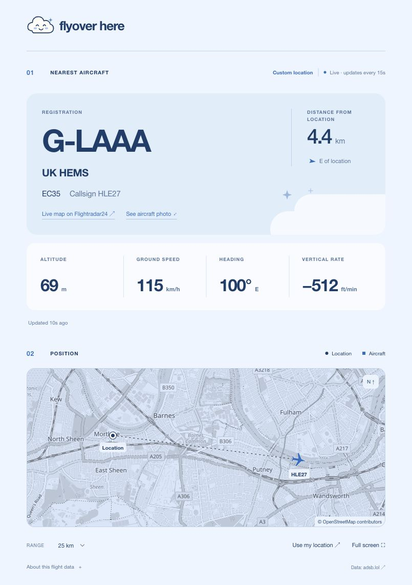

# Flyover Here

**What’s up?**

A whimsical plane-spotting app that shows the nearest aircraft overhead, with live flight data, a map, and aircraft photos.



## What it does

- Shows one aircraft at a time: the closest reported airborne aircraft to your location.
- Leads with the aircraft registration, followed by the operator and flight number when available.
- Displays aircraft type, callsign, distance, altitude, ground speed, heading, and vertical rate.
- Fits your location and the aircraft onto a blue-washed map.
- Opens aircraft photos in a lightbox, with photographer credit, and links to Flightradar24’s live map.
- Offers 5, 10, 25, 50, and 100 km search radii.
- Keeps the current aircraft or “Clear skies for now” visible during background refreshes.
- Includes custom cloud illustrations, a responsive mobile layout, and full-screen mode.

## Run locally

Requires **Node.js 22.13 or newer** and npm.

```sh
git clone https://github.com/bluefuton/flyover-here.git
cd flyover-here
npm ci
npm run dev
```

Open the local URL printed by the server, normally **http://localhost:5173**. No API keys or database setup are required for the current features.

Allow browser location access to begin. Previously granted permission is reused when the browser exposes its permission state. Device location is watched while the page is open, with a new lookup after movement of at least 100 metres. A custom URL location stays fixed.

### Try another location through the URL

Supply both `lat` and `lon` to bypass device geolocation. There are no coordinate fields in the interface.

```text
# Mortlake, London
http://localhost:5173/?lat=51.4696&lon=-0.2665

# Heathrow
http://localhost:5173/?lat=51.4700&lon=-0.4543

# Near Battersea Park
http://localhost:5173/?lat=51.4791&lon=-0.1493
```

Remove the parameters or click the logo to return to device-location mode. In custom-location mode, **Use my location** switches to your device location directly.

## How aircraft are selected

The app searches the selected radius, excludes grounded aircraft and position reports older than 30 seconds, then chooses the shortest **ground distance** from the reference location. Nearby does not necessarily mean directly overhead. At busy airports, the selected aircraft can change as another becomes closer.

Successful lookups normally refresh about every 15 seconds. Hidden pages pause polling. Brief server-side caching and shared in-flight requests reduce duplicate upstream calls. Failures use increasing retry delays and respect the provider’s `Retry-After` header. Old aircraft positions are hidden after 45 seconds without a successful update.

## Data sources and limits

| Source                                                       | Used for                                                                                                   |
| ------------------------------------------------------------ | ---------------------------------------------------------------------------------------------------------- |
| [adsb.lol](https://www.adsb.lol/docs/open-data/api/)         | Live aircraft positions and reported telemetry; [ODbL 1.0](https://opendatacommons.org/licenses/odbl/1-0/) |
| [adsbdb](https://www.adsbdb.com/)                            | Operator names and available IATA flight identifiers                                                       |
| [Planespotters.net](https://www.planespotters.net/photo/api) | Photos matched by ICAO aircraft ID, linked to the original with photographer credit                        |
| [OpenStreetMap](https://www.openstreetmap.org/copyright)     | Map tiles and geographic data, with visible attribution                                                    |

Coverage varies with receiver availability and provider uptime. The public services may rate-limit requests.

A radio callsign can differ from the passenger flight number. The app uses adsbdb’s IATA identifier only when it has a plausible airline-code-plus-number format; it does not present alphanumeric callsign substitutions as passenger flight numbers. This lookup is not independent verification against a live airline schedule. Missing flight numbers are omitted.

Aircraft photos may show an earlier livery. Altitude is reported barometric altitude, not height above your location. Display units are kilometres, metres, and km/h; vertical rate retains the aviation convention of feet per minute. This is a curiosity tool, not a navigation aid.

## Location and privacy

Device coordinates are held in application memory, sent to this app’s lookup endpoint, and forwarded to adsb.lol. The app does not persist device coordinates to browser storage or a database. OpenStreetMap receives requests for the viewed map tiles. Optional URL overrides remain visible in the address bar and browser history, so use public test locations in links you share.

## Development

Built with **React, TypeScript, Vinext, Vite, and Tailwind CSS**, with server handlers targeting Cloudflare Workers. Map layout uses a small Web Mercator implementation rather than a map-library dependency.

```sh
npm test           # Offline tests for selection, map fitting, URL overrides and API failure handling
npm run typecheck  # TypeScript checks
npm run build      # Build the app and Worker
npm start          # Preview the built Worker locally; does not deploy
```

The project retains its Sites/Cloudflare scaffolding. `.openai/hosting.json` contains hosting metadata; it is not needed to obtain flight API credentials. No production deployment or GitHub deployment workflow is triggered by these commands.

Source code lives in `app/`, `components/`, and `lib/`. Tests live in `tests/`; screenshots live in `docs/`. Generated builds, local runtime state, dependencies, and `.env` files are ignored by Git.
